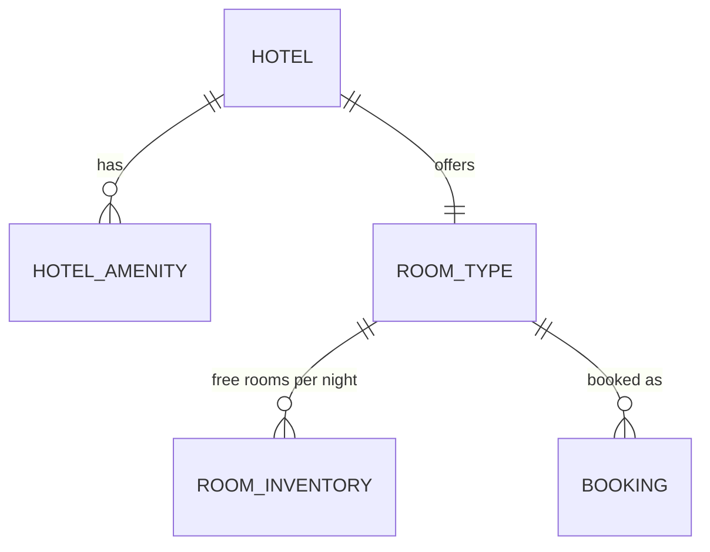

# Design Notes – StayEasy Hotel Booking Portal

## 1. Architecture

```
Angular (browser, :4200)  --HTTP/JSON-->  Spring Boot REST API (:8080)  --JPA/JDBC-->  MySQL
```

- **Frontend (Angular 19):** four pages – search, hotel detail (availability + booking), confirmation,
  and manage booking. All API calls go through one `ApiService`. In development the Angular dev server
  proxies `/api` to the backend, so the browser sees a single origin and no CORS configuration is needed.
- **Backend (Spring Boot 3):** classic layered structure.
  - `controller` – thin REST controllers; only map HTTP to service calls.
  - `service` – all business rules: date validation, pricing, availability, booking, cancellation.
  - `repository` – Spring Data JPA interfaces, including the atomic inventory update queries.
  - `entity` / `dto` – entities are never returned directly; responses are Java records (DTOs).
  - `exception` – one `@RestControllerAdvice` turns every error into the same `ApiError` JSON.
- **Database (MySQL 8):** schema and sample data are versioned with **Flyway** migrations, so any machine
  gets the same database by just starting the app. Hibernate does not create or change tables (`ddl-auto=none`).

The backend is the single source of truth: the frontend never calculates a price or decides availability
on its own; it only shows what the API returns.

## 2. Database design



| Table | Purpose | Important constraints |
|---|---|---|
| `hotel` | Name, location, address, description | index on `location` for search |
| `hotel_amenity` | One row per amenity (normalised instead of a comma-separated string) | PK (`hotel_id`, `amenity`), FK to hotel |
| `room_type` | Room category, price per night, total rooms | `UNIQUE(hotel_id)` = one category per hotel; `price > 0`, `total_rooms > 0` |
| `room_inventory` | Free rooms of a room type for **one night** | `UNIQUE(room_type_id, stay_date)`; `CHECK(available_rooms >= 0)` |
| `booking` | Guest, dates, nights, price snapshot, total, status | `UNIQUE(booking_reference)`; `CHECK(check_out > check_in)`; status limited to CONFIRMED/CANCELLED; index on (room_type, dates) |

Notes:
- `room_type` is a separate table (not columns on `hotel`) so more categories can be added later by only
  dropping the unique constraint.
- `booking` copies `price_per_night` and stores `total_amount`, so changing a hotel's price later does not
  change old bookings.
- Money uses `DECIMAL`, never floating point.
- `room_inventory` rows are created by the application for a rolling 365-day window
  (`InventoryService.fillBookingWindow`, run at startup and every night just after midnight).

## 3. API design

| Method | Endpoint | Purpose | Main responses |
|---|---|---|---|
| GET | `/api/hotels?location=&checkIn=&checkOut=` | Browse / search. With dates, each hotel also shows free rooms and total | 200, 400 (bad dates) |
| GET | `/api/hotels/locations` | Cities for the search box suggestions | 200 |
| GET | `/api/hotels/{id}` | Hotel details and room info | 200, 404 |
| GET | `/api/hotels/{id}/availability?checkIn=&checkOut=` | Free rooms, nights, price/night, total; alternative dates if sold out | 200, 400, 404 |
| POST | `/api/bookings` | Create booking `{hotelId, guestName, guestEmail, checkIn, checkOut}` | 201, 400, 404, 409 (no room) |
| GET | `/api/bookings/{reference}?email=` | Retrieve a booking | 200, 404 |
| POST | `/api/bookings/{reference}/cancel` | Cancel `{email}` | 200, 400 (stay started), 404, 409 (already cancelled) |

- Cancel is a `POST .../cancel` action instead of `DELETE`, because the booking is not deleted – it changes
  status and stays in history.
- Retrieving and cancelling need **both** reference and email. If either is wrong, the same 404 message is
  returned, so the API does not reveal whether a reference exists.
- Error format is the same everywhere: `timestamp, status, error, message, path, fieldErrors`.
  `fieldErrors` is filled for bean-validation failures (e.g. `{"guestEmail": "Enter a valid email address"}`)
  and the frontend shows those under the matching input.

## 4. Booking logic

**Date validation** (`BookingRules`, used for search, availability and booking):
- both dates required; check-in not before today; check-out strictly after check-in;
- maximum 30 nights; stay must fall inside the 365-day booking window.
- "Today" comes from an injected `Clock` (Asia/Kolkata), which makes the rules easy to unit-test with a fixed date.

**Pricing:** `total = pricePerNight × nights`, where `nights = days between check-in and check-out`.
Calculated only on the backend with `BigDecimal`. The availability endpoint returns the same total that
the booking endpoint will charge, so the user sees the final amount before confirming.

**Overlapping stays:** a stay occupies the nights `[checkIn, checkOut)`. Booking 10th→12th uses the nights of
the 10th and 11th. A new guest can check in on the 12th. Two stays overlap only if they share a night.

**Availability check:** free rooms for a stay = the **minimum** `available_rooms` over all its nights
(the busiest night decides). If a night has no inventory row (outside the window), it counts as 0.

**Booking** (`BookingService.createBooking`, one transaction):
1. validate dates and find the hotel's room type;
2. run one conditional update that takes a room on every night of the stay **only if** that night still has one:
   ```sql
   UPDATE room_inventory SET available_rooms = available_rooms - 1
   WHERE room_type_id = ? AND stay_date >= ? AND stay_date < ? AND available_rooms > 0
   ```
3. if the number of updated rows is not equal to the number of nights, some night was full →
   throw `ConflictException` (HTTP 409) and the transaction rolls back, so no night stays half-reserved;
4. otherwise save the booking with a random reference like `HB7K2M9QXR`
   (`SecureRandom`, no confusing characters such as 0/O and 1/I; uniqueness checked and enforced by a unique key).

**Cancellation** (`BookingService.cancelBooking`, one transaction): find the booking with a row lock,
check the email, reject if already cancelled (409) or if the stay has already started (400), set status
`CANCELLED`, and add one room back to each night of the stay.

## 5. Design decisions and trade-offs

| Decision | Alternative considered | Why this choice |
|---|---|---|
| Per-night inventory table | Count overlapping bookings each time | Availability is stored explicitly (as the brief asks), checks are simple, and the conditional update makes double-booking impossible. Trade-off: rows must be created ahead for each date. |
| Conditional `UPDATE ... WHERE available_rooms > 0` | Pessimistic lock on the room type, or optimistic `@Version` | One SQL statement does check + reserve atomically; no retry loop, and only the affected nights are locked, not the whole hotel. |
| Flyway migrations | `ddl-auto=update` / manual scripts | Repeatable, versioned schema; same scripts run in tests (H2) and in MySQL. |
| DTO records for responses | Returning entities | Avoids lazy-loading and JSON recursion issues, and keeps the API stable if entities change. |
| Search state in the URL (Angular) | Keeping it only in component state | Refresh, back button and sharing a link keep the same results. |
| Template-driven forms | Reactive forms | Forms are small; this keeps the code short and easy to read. |
| Proxy in dev instead of CORS | `@CrossOrigin` on controllers | No security setting to maintain; production would serve both from one domain anyway. |

## 6. Simultaneous bookings (two users, last room)

Suppose Heritage Haveli has 1 room left for 20th–22nd and users A and B press "Confirm" at the same moment.

1. Both requests run the conditional `UPDATE` on the same `room_inventory` rows.
2. InnoDB takes a row lock for A's update. B's update waits on that lock.
3. A's update sees `available_rooms = 1`, changes it to 0, and A's transaction commits.
4. B's update now continues. For an `UPDATE`, MySQL re-reads the **latest committed** value, finds
   `available_rooms = 0`, so `available_rooms > 0` is false and 0 rows are updated.
5. B's service sees "updated nights ≠ stay nights", throws `ConflictException`, and B's transaction rolls back.
   B gets HTTP 409 "no rooms left", and the frontend refreshes availability and shows the nearest free dates.

So the check and the reservation are one atomic step – there is no gap between "check" and "book" where
another user could slip in. As a last line of defence, `CHECK (available_rooms >= 0)` in the database makes
an over-booking impossible even if some future code forgot the condition.

Cancellation uses `SELECT ... FOR UPDATE` on the booking row, so the same booking cannot be cancelled twice
in parallel (which would otherwise release the room twice).

With very high traffic, deadlocks could happen if two stays lock overlapping dates in different order;
the update touches rows in index order, which reduces this, and a retry on deadlock could be added.

## 7. Surprise feature – nearest free dates

**What it does:** if the hotel is sold out for the selected dates, the availability response includes up to
three alternative stays with the same number of nights, closest first (1 day earlier, 1 day later, 2 days
earlier, ... up to 7 days), each with its total price. In the UI they appear as buttons under the
"fully booked" message; clicking one fills in those dates and re-checks availability, so the user can book in one more click.

**Why:** a plain "sold out" message is a dead end – the user has to guess other dates and try one by one.
Many travellers have some flexibility, and the hotel would rather fill the room than lose the guest.
It is small, but directly reduces failed searches and abandoned bookings.

**How:** `AlternativeDatesService.findNearestAvailable` reuses the existing pieces – `BookingRules` to skip
dates in the past or outside the window, and `InventoryService.availableRooms` to check each candidate.
It is only called when the requested stay has 0 rooms, so normal requests have no extra cost.
The frontend shows the suggestions and, when a booking fails with 409 (someone took the last room), it
automatically refreshes availability so the suggestions appear immediately. It is covered by an
integration test (`soldOutDatesSuggestTheNearestFreeDates`).

## 8. Testing

- `BookingRulesTest` (unit, fixed clock): price × nights, nights over a month end, check-in today allowed,
  past check-in rejected, check-out on/before check-in rejected, max stay, booking window.
- `BookingFlowIntegrationTest` (Spring Boot + H2 in MySQL mode, real Flyway scripts):
  booking reduces availability and charges per night; last room cannot be booked twice;
  stay starting on another guest's check-out day is allowed but a real overlap is not;
  a failed booking rolls back all nights; cancel releases the room and cannot be repeated;
  booking is only found with the matching email; sold-out dates return the nearest free dates.

## 9. Limitations and improvements

- **Inventory window:** rows are generated for 365 days. Changing a hotel's `total_rooms` needs the future
  inventory rows to be adjusted too (would be an admin feature).
- **Concurrency test:** the parallel "last room" case is explained above but not covered by an automated
  multi-threaded test; with more time I would add one using Testcontainers with real MySQL.
- **No authentication:** booking access is protected only by reference + email. Real systems would email
  a link or OTP. Rate limiting on lookup would also be needed.
- **No emails:** confirmation is shown on screen only; sending an email would be the next step.
- **Single room category and one room per booking** (as the brief allows).
- **Frontend tests** are not included; I would add component tests for the booking form and an end-to-end
  test (Playwright/Cypress) for the main flow.
- **Production setup:** build Angular and serve it from Spring Boot or Nginx, add Docker Compose for
  MySQL + app, and pagination/filters (price, amenities) for larger hotel lists.
