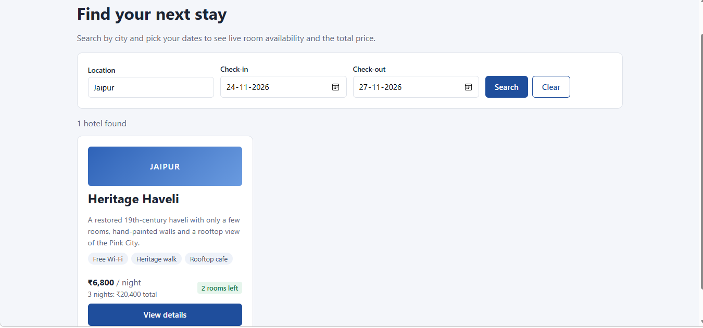
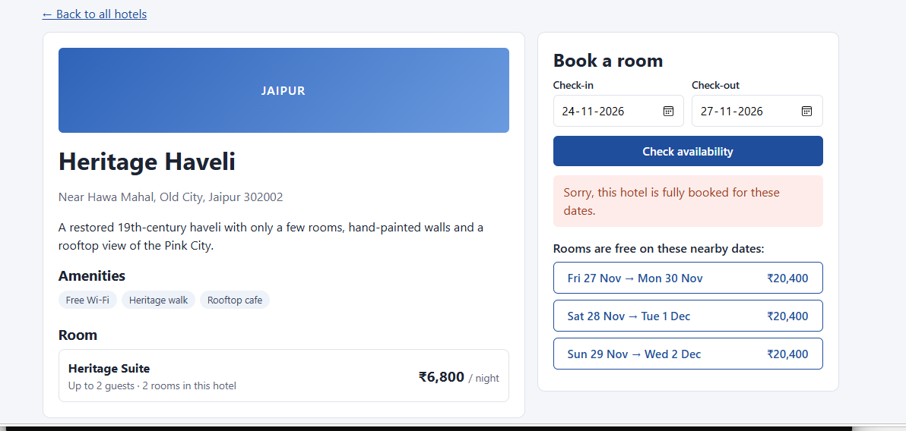
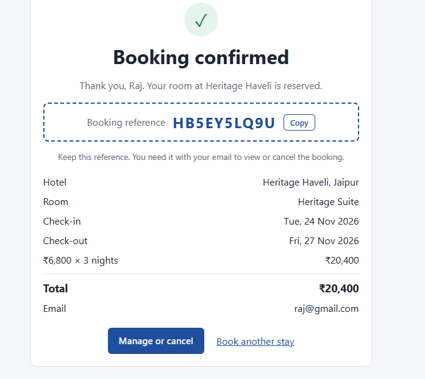
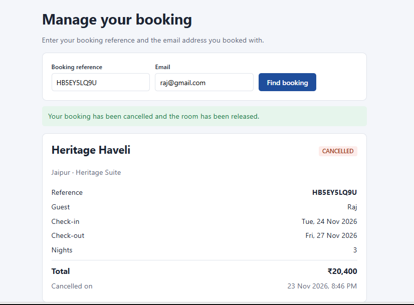
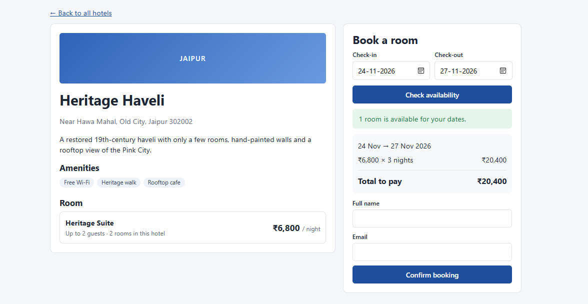
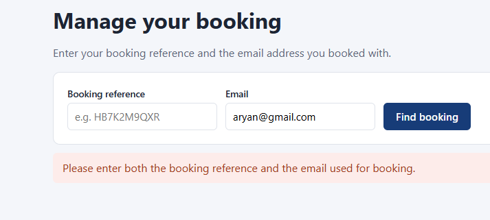

# StayEasy – Hotel Booking Portal

A small hotel booking portal built with **Spring Boot (Java)**, **Angular** and **MySQL**.

Users can browse and search hotels, check room availability for their dates, see the total price,
book a room, and later find or cancel the booking using the booking reference and email.

**Surprise feature – "nearest free dates":** when a hotel is sold out for the chosen dates, the app
suggests up to three of the closest dates (same number of nights) that still have a room. One click
re-checks those dates and the user can book straight away.

See [DESIGN.md](DESIGN.md) for architecture, database design, booking logic and design decisions.

---

## Screenshots

| Search with dates | Sold out → nearest free dates |
|---|---|
|  |  |

| Booking confirmation | Manage / cancel booking |
|---|---|
|  |  |

| Total shown before booking | Validation message |
|---|---|
|  |  |

---

## Tech stack

| Layer | Technology |
|---|---|
| Backend | Java 17+, Spring Boot 3.3 (Web, Data JPA, Validation), Flyway |
| Frontend | Angular 19 (standalone components), TypeScript |
| Database | MySQL 8 (tests use H2 in MySQL mode) |
| Tests | JUnit 5, AssertJ, Spring Boot Test |

## Prerequisites

- **JDK 17 or newer** (JDK 21 recommended) – `java -version`
- **Node.js 20 or 22 LTS** with npm – `node -v`
- **MySQL 8.0.16 or newer** (needed for CHECK constraints) – `mysql --version`
- Git

Maven does not need to be installed: the backend includes the Maven Wrapper (`mvnw` / `mvnw.cmd`).

---

## How to run locally

### 1. Clone the repository

```bash
git clone https://github.com/<your-username>/hotel-booking-portal.git
cd hotel-booking-portal
```

### 2. Create the database

Open `database/create_database.sql`, change the password `change_me` to your own, then run it as the MySQL root user:

```bash
mysql -u root -p < database/create_database.sql
```

This only creates an empty database `hotel_booking` and a user `hotel_app`.
**Tables and sample data are created automatically** by Flyway when the backend starts
(scripts are in `backend/src/main/resources/db/migration`).

### 3. Configure database credentials

Credentials are not stored in the repository. Copy the example file and put in your password:

```bash
cd backend
cp .env.example .env        # Windows: copy .env.example .env
```

Edit `backend/.env` and set `DB_PASSWORD` to the password from step 2.
(`.env` is git-ignored. Environment variables with the same names also work.)

### 4. Start the backend (port 8080)

```bash
cd backend
./mvnw spring-boot:run      # Windows: mvnw.cmd spring-boot:run
```

The first run downloads Maven and the dependencies, so it takes a few minutes.
When you see `Started HotelBookingApplication`, check: http://localhost:8080/api/hotels

### 5. Start the frontend (port 4200)

In a second terminal:

```bash
cd frontend
npm install
npm start
```

Open **http://localhost:4200**. The Angular dev server forwards `/api` calls to the backend (`frontend/proxy.conf.json`), so no CORS setup is needed.

### 6. Run the automated tests

```bash
cd backend
./mvnw test                 # Windows: mvnw.cmd test
```

Tests use an in-memory H2 database with the same Flyway scripts, so MySQL is not needed for tests.

---

## Sample data

Six hotels are loaded by `V2__sample_data.sql`:

| Hotel | Location | Price / night | Rooms |
|---|---|---|---|
| Sea Breeze Residency | Mumbai | ₹5,500 | 10 |
| Palm Grove Beach Resort | Goa | ₹4,200 | 8 |
| Heritage Haveli | Jaipur | ₹6,800 | **2** |
| Lakeview Palace Inn | Udaipur | ₹7,500 | 6 |
| Snow Peak Lodge | Manali | ₹3,200 | 5 |
| Backwater Retreat | Kochi | ₹3,900 | 7 |

**Quick way to test "sold out" and the surprise feature:** book Heritage Haveli (Jaipur) twice
for the same dates. A third attempt shows "fully booked" with the nearest free dates.

---

## API overview

| Method | Endpoint | Purpose |
|---|---|---|
| GET | `/api/hotels?location=&checkIn=&checkOut=` | List/search hotels (dates optional) |
| GET | `/api/hotels/locations` | Distinct cities for the search box |
| GET | `/api/hotels/{id}` | Hotel details and room info |
| GET | `/api/hotels/{id}/availability?checkIn=&checkOut=` | Free rooms, nights, total price, alternative dates |
| POST | `/api/bookings` | Create a booking |
| GET | `/api/bookings/{reference}?email=` | Find a booking |
| POST | `/api/bookings/{reference}/cancel` | Cancel a booking (body: `{"email": "..."}`) |

Example:

```bash
curl -X POST http://localhost:8080/api/bookings \
  -H "Content-Type: application/json" \
  -d '{"hotelId":3,"guestName":"Raj Kapoor","guestEmail":"raj@example.com","checkIn":"2026-12-20","checkOut":"2026-12-22"}'
```

All errors use one JSON format:

```json
{
  "timestamp": "2026-11-23T10:15:30Z",
  "status": 409,
  "error": "Conflict",
  "message": "Sorry, no rooms are left for these dates. Please try other dates.",
  "path": "/api/bookings",
  "fieldErrors": null
}
```

---

## Project structure

```
hotel-booking-portal/
├── backend/                     Spring Boot REST API
│   ├── src/main/java/com/hotelbooking/
│   │   ├── controller/          REST endpoints
│   │   ├── service/             Booking rules, availability, booking logic
│   │   ├── repository/          Spring Data JPA repositories
│   │   ├── entity/              JPA entities
│   │   ├── dto/                 Request/response objects
│   │   ├── exception/           Exceptions + global error handler
│   │   └── config/              Clock configuration
│   ├── src/main/resources/db/migration/   Flyway schema + sample data
│   └── src/test/                Unit and integration tests
├── frontend/                    Angular app (pages: search, hotel detail, confirmation, manage)
├── database/create_database.sql Creates the database and app user
├── docs/screenshots/
├── README.md
└── DESIGN.md
```

---

## Assumptions

- One room category per hotel; a booking is for exactly one room.
- A stay uses the nights from check-in up to, but not including, check-out. So a guest checking out
  on the 12th does not block a new guest checking in on the 12th.
- Check-in today is allowed. Maximum stay is 30 nights, and bookings open up to 365 days ahead
  (both configurable in `application.properties`).
- All dates are hotel-local dates in Indian Standard Time.
- Prices are in INR and stored with the booking, so a later price change does not affect existing bookings.
- A booking can be cancelled up to and including the check-in day. Cancelled bookings are kept
  with status `CANCELLED` (not deleted).
- A booking can only be viewed or cancelled with the matching reference **and** email.

## Time spent and unfinished items

- Approximate time spent: **TODO – fill in your real hours**
- Not done (out of scope or time): authentication, payments, admin panel, email notifications,
  multiple room categories, frontend unit tests. See "Limitations" in DESIGN.md.

## Use of AI tools

**TODO – write this in your own words before submitting.** The assignment asks for significant AI
assistance to be disclosed. Example: "I used Claude (Anthropic's AI assistant) to help generate the initial
code structure and documentation. I reviewed, ran and tested all of it, and I can explain every part."
